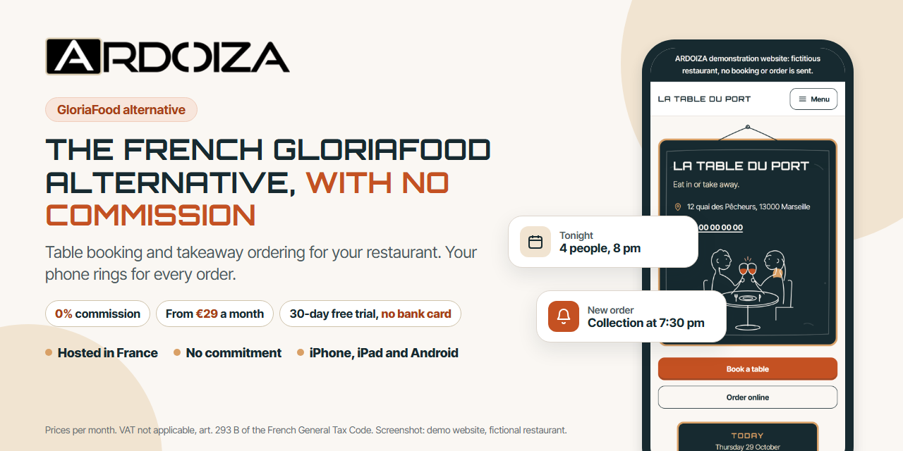
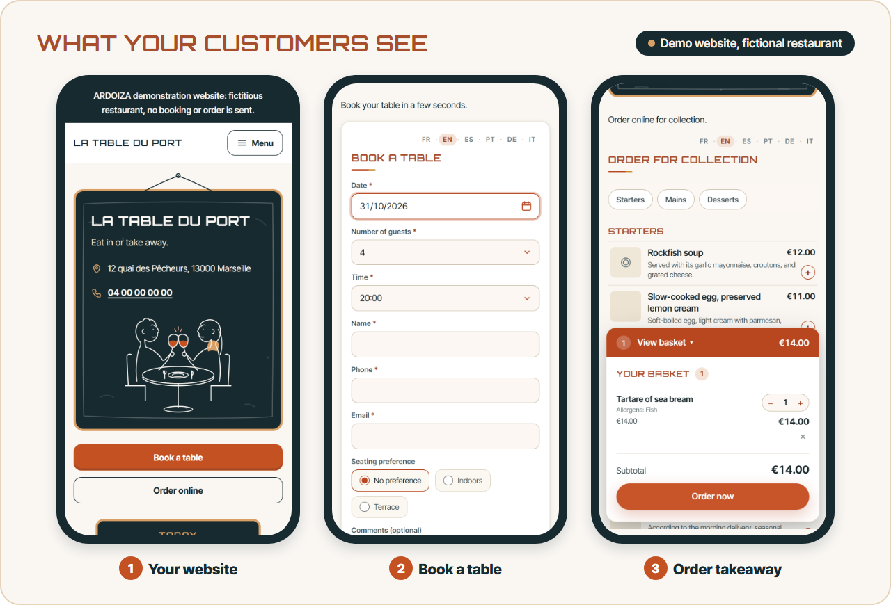
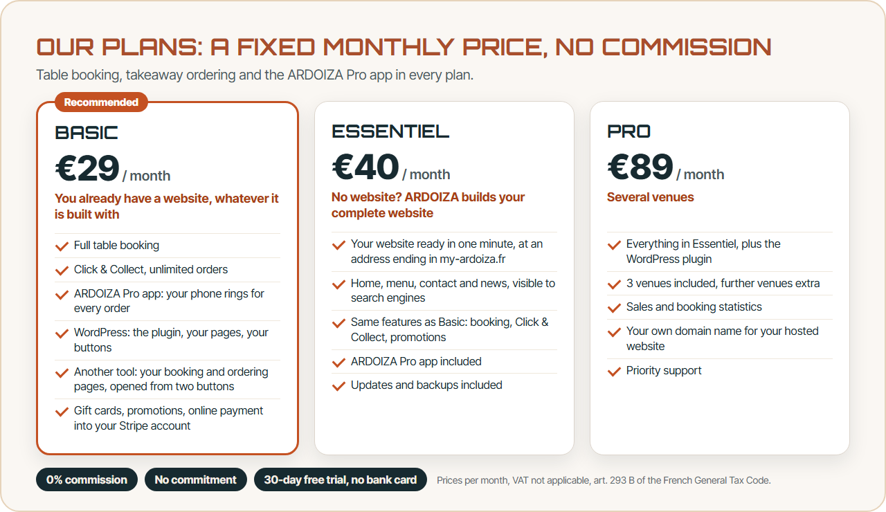
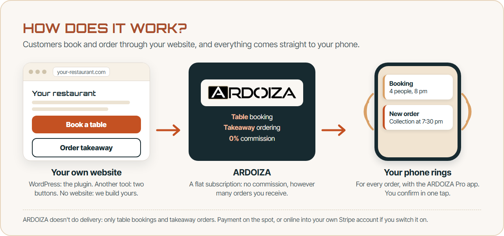
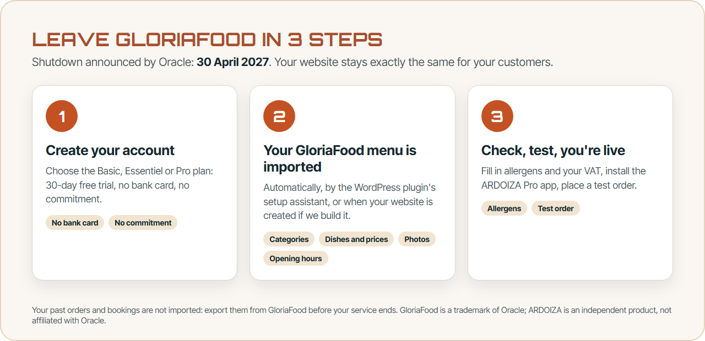
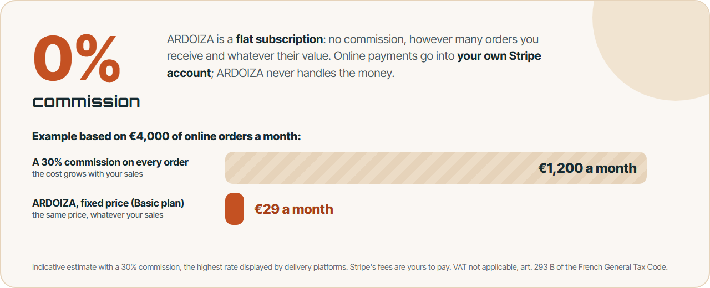
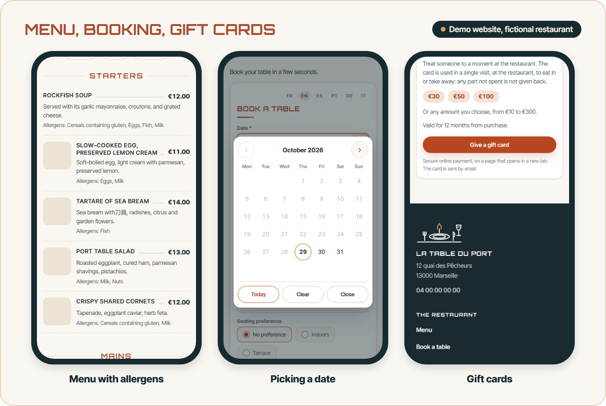
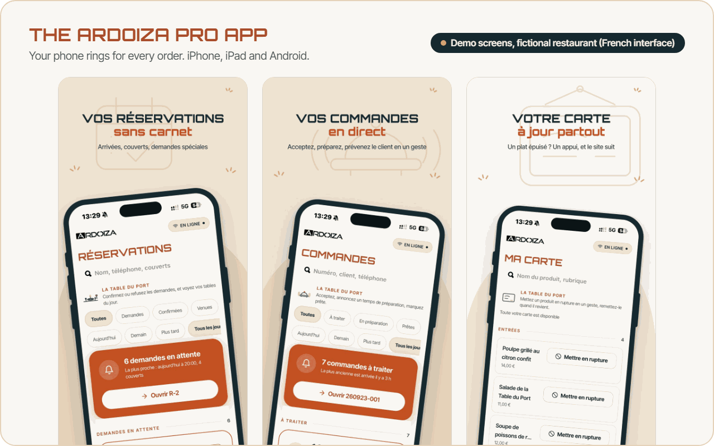

  

  
  

<a href="README.md">Français</a> · <b>English</b>

# ARDOIZA, the French GloriaFood alternative with no commission

GloriaFood shuts down on **30 April 2027** ([Oracle FAQ](https://www.oracle.com/webfolder/dms/prod/d3/FAQs-GL.pdf), March 2026). ARDOIZA imports your GloriaFood menu and takes over table booking and takeaway ordering, from your own website.

- **Table booking and takeaway ordering** from your website, whatever it is built with.
- **0% commission**: a fixed price, from €29 a month, no commitment (VAT not applicable, art. 293 B of the French General Tax Code).
- **Your phone rings for every order**, with the ARDOIZA Pro app.

## Our plans

| Plan | Price per month | Who it is for |
|---|---|---|
| **Basic** | €29 | You already have a website, whatever it is built with: WordPress (the plugin) or another tool (your booking and ordering pages, opened from two buttons). |
| **Essentiel** | €40 | No website? ARDOIZA builds your complete website and looks after it. |
| **Pro** | €89 | Several venues: 3 included, your own domain name, statistics. |

0% commission, no commitment, 30-day free trial with no bank card needed: you only add your card to carry on. Prices per month, VAT not applicable, art. 293 B of the French General Tax Code. Sign-up is currently open to businesses registered in France (SIRET number required).

  

## How does it work?

1. **Your website** carries two buttons: "Book a table" and "Order takeaway". WordPress website: the plugin. Website built with another tool: two links. No website: ARDOIZA builds yours.
2. **Your customers book** (date, time, number of guests) **and order** for collection. They pay on collection, or online by card into your own Stripe account if you switch it on.
3. **Your phone rings** for every order. You accept with a preparation time, and confirm bookings in one tap.

ARDOIZA doesn't do delivery: only table bookings and takeaway orders.

## Leave GloriaFood in 3 steps

1. **Create your account**: Basic, Essentiel or Pro plan, 30-day free trial, no bank card, no commitment.
2. **Your GloriaFood menu is imported** automatically: categories, dishes, prices, options, photos, promotions and opening hours. By the WordPress plugin's setup assistant, or when your website is created if ARDOIZA builds it (you just give us your restaurant's GloriaFood ID).
3. **Check, test, you're live**: fill in allergens and your VAT, install the ARDOIZA Pro app, place a test order.

Your past orders and bookings are not imported: export them from GloriaFood before your service ends. To keep a copy of your menu (dishes, prices, sizes, options, photos) as CSV and JSON, use our free tool [gloriafood-menu-export](https://github.com/robibi14/gloriafood-menu-export).

The full walkthrough: [Migrate from GloriaFood](https://www.ardoiza.fr/en/migrate-from-gloriafood/?utm_source=github&utm_medium=readme&utm_campaign=vitrine&utm_content=en-migration)

## 0% commission

ARDOIZA is a fixed monthly subscription: no commission on your bookings or orders, however many there are and whatever their value. Online payments go into your own Stripe account, in your name; ARDOIZA never handles the money, and Stripe's fees are yours to pay.

## Online menu, allergens and gift cards

- **Online menu** with prices and allergens, and its **QR code** for your tables.
- **Gift cards** sold online into your Stripe account, with no ARDOIZA commission, redeemed at the counter.
- **Promotions and promo codes**, and a booking deposit if you want one.

## The ARDOIZA Pro app

Your phone rings for every order, even when the app is closed. You accept, decline, set the preparation time, confirm bookings and flag a dish as sold out. Included at no extra cost in Basic, Essentiel and Pro, on iPhone, iPad and Android.

  
  

## Frequently asked questions

**Do I need to rebuild my website?**
No. Your website stays as it is, whatever it is built with. With WordPress, the plugin installs on it; with another tool, the Basic plan creates your booking and ordering pages, and you link them from your website with two links.

**I don't have a website. Is that a problem?**
No. With the Essentiel and Pro plans, ARDOIZA builds and hosts your website: home, menu, ordering, booking, contact, in your name and your colours.

**What about my delivery orders?**
ARDOIZA doesn't do delivery, and that is a deliberate choice. We focus on table booking and orders for collection, with no commission.

**Can I try it before I commit?**
Yes. One free trial per account, on the Basic, Essentiel or Pro plan of your choice: 30 days free, no bank card needed. Without a card, the trial stops and nothing is taken.

**Where is my data hosted?**
Your account and the websites we host are in France, with OVH (Gravelines). No advertising trackers.

**Who answers me?**
Support replies in writing, from a real person, within an indicative 24 hours, Monday to Friday excluding public holidays: [contact@ardoiza.fr](mailto:contact@ardoiza.fr).

All the answers: [FAQ](https://www.ardoiza.fr/en/faq/?utm_source=github&utm_medium=readme&utm_campaign=vitrine&utm_content=en-faq)

## Try ARDOIZA in your restaurant

  
  

  

### Read more

- [GloriaFood alternative](https://www.ardoiza.fr/en/gloriafood-alternative/?utm_source=github&utm_medium=readme&utm_campaign=vitrine&utm_content=en-links): what is imported, what is not, the suggested timeline
- [GloriaFood shutting down](https://www.ardoiza.fr/en/gloriafood-shutting-down/?utm_source=github&utm_medium=readme&utm_campaign=vitrine&utm_content=en-links): dates and timeline
- [Our plans in detail](https://www.ardoiza.fr/en/pricing/?utm_source=github&utm_medium=readme&utm_campaign=vitrine&utm_content=en-links)
- [gloriafood-menu-export](https://github.com/robibi14/gloriafood-menu-export): export your GloriaFood menu to CSV and JSON

---

The screenshots come from ARDOIZA's demo website, a fictional restaurant; no booking or order is ever sent from it. GloriaFood is a trademark of Oracle and/or its affiliates. ARDOIZA is an independent product, not affiliated with Oracle. App Store is a trademark of Apple Inc.; Google Play is a trademark of Google LLC. Texts and illustrations under the CC BY 4.0 licence, except the ARDOIZA logo and trademark: see [LICENSE](LICENSE).
