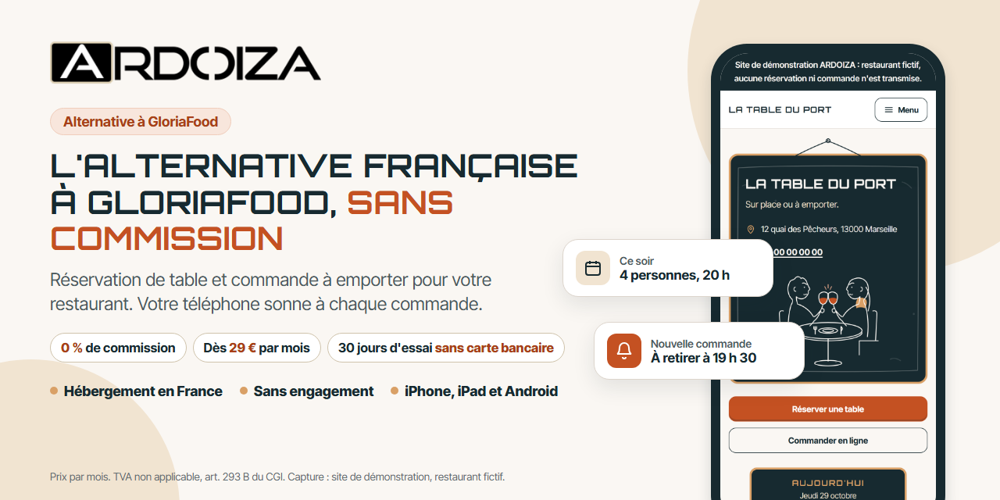
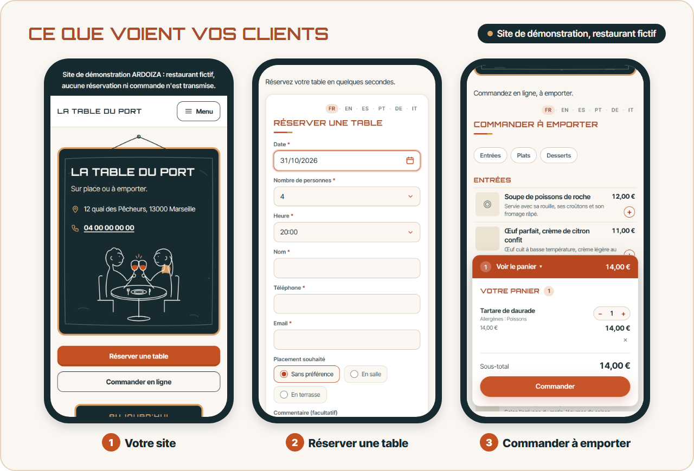
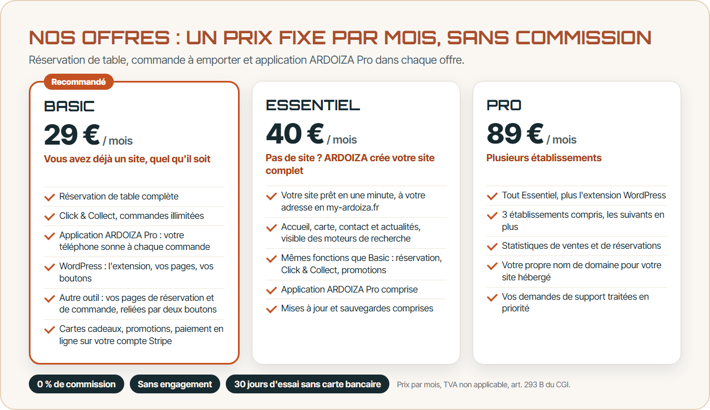
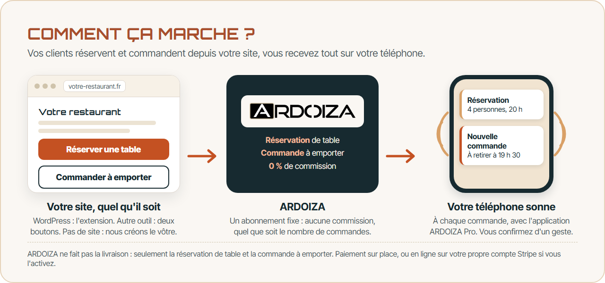
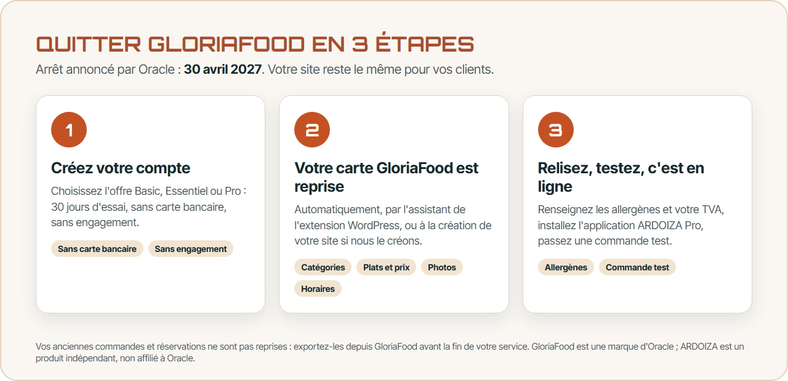
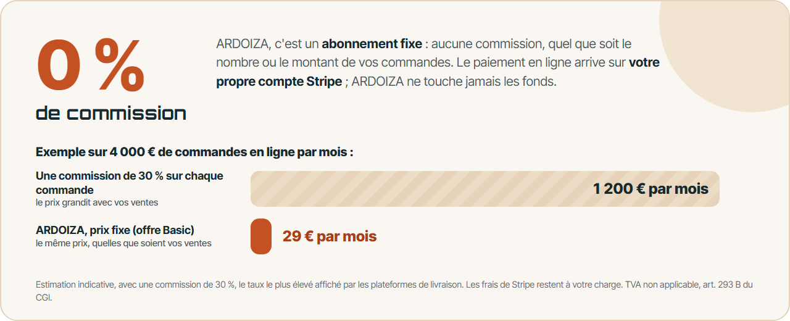
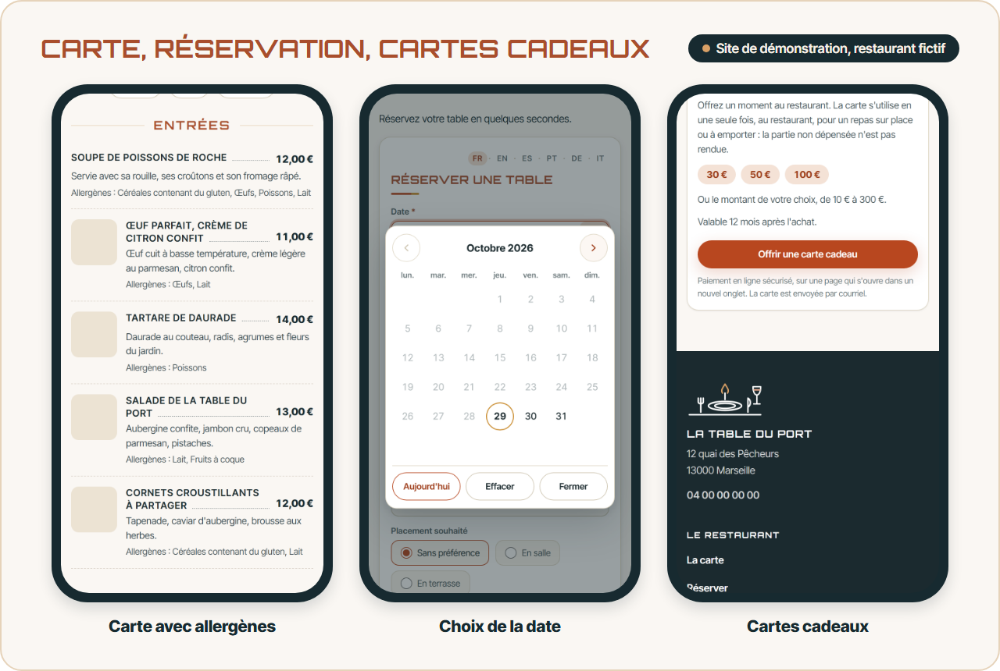
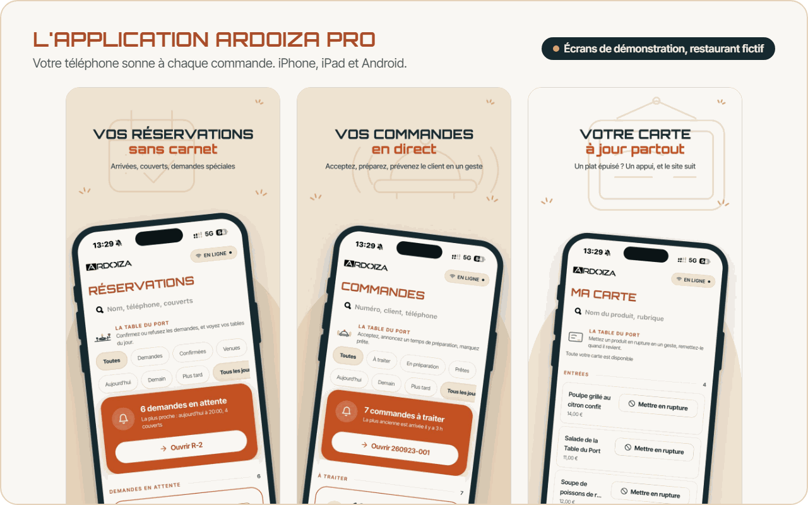

  

  
  

<b>Français</b> · <a href="README.en.md">English</a>

# ARDOIZA, l'alternative française à GloriaFood, sans commission

GloriaFood s'arrête le **30 avril 2027** ([FAQ d'Oracle](https://www.oracle.com/webfolder/dms/prod/d3/FAQs-GL.pdf), mars 2026). ARDOIZA reprend votre carte GloriaFood et prend le relais pour la réservation de table et la commande à emporter, depuis votre site.

- **Réservation de table et commande à emporter** depuis votre site, quel qu'il soit.
- **0 % de commission** : un prix fixe, dès 29 € par mois, sans engagement (TVA non applicable, art. 293 B du CGI).
- **Votre téléphone sonne à chaque commande**, avec l'application ARDOIZA Pro.

## Nos offres

| Offre | Prix par mois | Pour qui |
|---|---|---|
| **Basic** | 29 € | Vous avez déjà un site, quel qu'il soit : WordPress (l'extension) ou un autre outil (vos pages de réservation et de commande, reliées par deux boutons). |
| **Essentiel** | 40 € | Pas de site ? ARDOIZA crée votre site complet et s'en occupe. |
| **Pro** | 89 € | Plusieurs établissements : 3 compris, votre propre nom de domaine, statistiques. |

0 % de commission, sans engagement, 30 jours d'essai sans carte bancaire : vous ajoutez votre carte seulement pour continuer. Prix par mois, TVA non applicable, art. 293 B du CGI. Inscription ouverte aux entreprises immatriculées en France (SIRET demandé).

  

## Comment ça marche ?

1. **Votre site** porte deux boutons : « Réserver une table » et « Commander à emporter ». Site WordPress : l'extension. Site fait avec un autre outil : deux liens. Pas de site : ARDOIZA crée le vôtre.
2. **Vos clients réservent** (date, heure, couverts) **et commandent** à retirer sur place. Paiement au retrait, ou en ligne par carte sur votre propre compte Stripe si vous l'activez.
3. **Votre téléphone sonne** à chaque commande. Vous acceptez en annonçant un temps de préparation, vous confirmez les réservations d'un geste.

ARDOIZA ne fait pas la livraison : seulement la réservation de table et la commande à emporter.

## Quitter GloriaFood en 3 étapes

1. **Créez votre compte** : offre Basic, Essentiel ou Pro, 30 jours d'essai, sans carte bancaire, sans engagement.
2. **Votre carte GloriaFood est reprise** automatiquement : catégories, plats, prix, options, photos, promotions et horaires. Par l'assistant de l'extension WordPress, ou à la création de votre site si ARDOIZA le crée (il suffit de donner l'identifiant de votre restaurant chez GloriaFood).
3. **Relisez, testez, c'est en ligne** : renseignez les allergènes et votre TVA, installez l'application ARDOIZA Pro, passez une commande test.

Vos anciennes commandes et réservations ne sont pas reprises : exportez-les depuis GloriaFood avant la fin de votre service. Pour garder une copie de votre carte (plats, prix, tailles, options, photos) en CSV et JSON, utilisez notre outil gratuit [gloriafood-menu-export](https://github.com/robibi14/gloriafood-menu-export).

Le pas à pas complet : [Migrer depuis GloriaFood](https://www.ardoiza.fr/migrer-depuis-gloriafood/?utm_source=github&utm_medium=readme&utm_campaign=vitrine&utm_content=fr-migration)

## 0 % de commission

ARDOIZA est un abonnement fixe : aucune commission sur vos réservations ni sur vos commandes, quel que soit leur nombre ou leur montant. Le paiement en ligne arrive sur votre propre compte Stripe, à votre nom ; ARDOIZA ne touche jamais les fonds, et les frais de Stripe restent à votre charge.

## Carte en ligne, allergènes et cartes cadeaux

- **Carte en ligne** avec prix et allergènes, et son **QR code** à poser sur vos tables.
- **Cartes cadeaux** vendues en ligne sur votre compte Stripe, sans commission ARDOIZA, encaissées au comptoir.
- **Promotions et codes promo**, et acompte de réservation si vous le souhaitez.

## L'application ARDOIZA Pro

Votre téléphone sonne à chaque commande, même application fermée. Vous acceptez, refusez, annoncez le temps de préparation, confirmez les réservations et signalez un plat en rupture. Comprise sans supplément dans Basic, Essentiel et Pro, sur iPhone, iPad et Android.

  
  

## Questions fréquentes

**Dois-je refaire mon site ?**
Non. Votre site reste tel qu'il est, quel que soit l'outil qui l'a fait. Avec WordPress, l'extension s'installe dessus ; avec un autre outil, l'offre Basic crée vos pages de réservation et de commande, et vous les reliez à votre site par deux liens.

**Je n'ai pas de site internet, est-ce un problème ?**
Non. Avec les offres Essentiel et Pro, ARDOIZA crée votre site et l'héberge : accueil, carte, commander, réserver, contact, à votre nom et à vos couleurs.

**Et mes commandes en livraison ?**
ARDOIZA ne fait pas la livraison : c'est un choix. Nous nous concentrons sur la réservation de table et la commande à retirer sur place, sans commission.

**Puis-je essayer avant de m'engager ?**
Oui. Un seul essai par compte, sur l'offre Basic, Essentiel ou Pro de votre choix : 30 jours offerts, sans carte bancaire. Sans carte, l'essai s'arrête et rien n'est prélevé.

**Où sont hébergées mes données ?**
Votre compte et les sites que nous hébergeons sont en France, chez OVH (Gravelines). Aucun traceur publicitaire.

**Qui me répond ?**
Le support répond par écrit, avec une réponse humaine, dans un délai indicatif de 24 heures, du lundi au vendredi hors jours fériés : [contact@ardoiza.fr](mailto:contact@ardoiza.fr).

Toutes les réponses : [Questions fréquentes](https://www.ardoiza.fr/questions/?utm_source=github&utm_medium=readme&utm_campaign=vitrine&utm_content=fr-faq)

## Essayez ARDOIZA dans votre restaurant

  
  

  

### Pour aller plus loin

- [Alternative à GloriaFood](https://www.ardoiza.fr/alternative-gloriafood/?utm_source=github&utm_medium=readme&utm_campaign=vitrine&utm_content=fr-liens) : ce qui est repris, ce qui ne l'est pas, le calendrier conseillé
- [Fin de GloriaFood](https://www.ardoiza.fr/fin-de-gloriafood/?utm_source=github&utm_medium=readme&utm_campaign=vitrine&utm_content=fr-liens) : les dates et le calendrier
- [Logiciel de réservation pour restaurant](https://www.ardoiza.fr/logiciel-reservation-restaurant/?utm_source=github&utm_medium=readme&utm_campaign=vitrine&utm_content=fr-liens), sans commission
- [Click and collect pour restaurant](https://www.ardoiza.fr/click-and-collect-restaurant/?utm_source=github&utm_medium=readme&utm_campaign=vitrine&utm_content=fr-liens) : la commande à emporter en ligne
- [Nos offres en détail](https://www.ardoiza.fr/tarifs/?utm_source=github&utm_medium=readme&utm_campaign=vitrine&utm_content=fr-liens)
- [gloriafood-menu-export](https://github.com/robibi14/gloriafood-menu-export) : exportez votre carte GloriaFood en CSV et JSON

---

Les captures viennent du site de démonstration d'ARDOIZA, un restaurant fictif ; aucune réservation ni commande n'y est transmise. GloriaFood est une marque d'Oracle ou de ses sociétés affiliées. ARDOIZA est un produit indépendant, non affilié à Oracle. App Store est une marque d'Apple Inc. ; Google Play est une marque de Google LLC. Textes et illustrations sous licence CC BY 4.0, sauf le logo et la marque ARDOIZA : voir [LICENSE](LICENSE).
